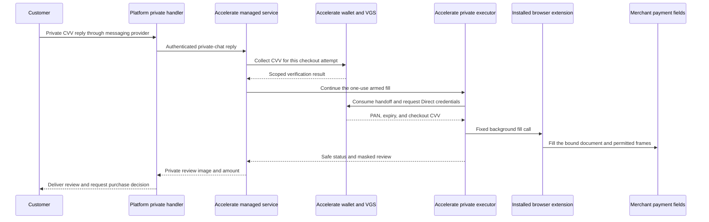

# Private CVV and credential delivery

Accelerate separates **customer verification** from **credential delivery to the browser extension**. Your private handler receives the customer's CVV reply. A later one-use Direct release supplies the payment fields to Accelerate's private executor, which passes them into the installed extension in the customer's existing checkout browser.

Here, private means that sensitive replies and payment credentials stay outside model prompts, ordinary chat history, and agent tools. Trusted backend services, the messaging provider, the extension, and the merchant payment fields still handle raw values. This is not a claim of end-to-end encryption between the customer and extension.

Start with [Agentic platforms](agentic-platforms.md) for setup. The [OpenInstinct reference](openinstinct-reference.md) shows how one application implements the same boundaries.

## The two data paths

The agent receives safe status and progress events. It does not receive the original CVV reply, Direct credential response, or access to the populated payment page through ordinary tools.

## 1. Collect CVV outside the agent

Your messaging ingress authenticates the provider request and resolves the customer, workspace, and direct conversation. It routes sensitive replies before logging, history caching, tracing, ordinary queues, or model processing.

The server-only `AcceleratePrivateChatClient.chat.reply()` sends the reply to `/v1/checkouts/{id}/private-chat/reply`. It binds the reply to the existing customer/workspace/conversation and the provider's stable message ID. The ordinary SDK and MCP tools have no CVV argument.

The managed service accepts CVV as a three- or four-digit string, preserving leading zeroes. It checks the selected card/address, frozen quote, checkout revision, staged fill intent, and remaining review time. It then submits the transient CVV to Accelerate's authenticated sensitive handler. That handler sends an HTTPS collection request to the configured VGS origin at `/wallet/vgs-inbound`.

In chat mode, this is a backend API submission to VGS. The raw reply passes through your messaging provider, private server handler, and Accelerate's sensitive handlers. It is not entered through a hosted VGS field in the chat application.

The private challenge is claimed once. Collection and subsequent verification receipts must match the authenticated merchant, shopper, selected card, `Direct` mode, and exact checkout attempt, with `requiresFreshCvv: true` and an unexpired verification result. The sealed challenge also binds the quote and address. A generic success response is insufficient.

Handlers clear mutable reply objects and buffers after use. Clients must also disable body capture and secret-bearing error logging. Clearing an object cannot remove a message already stored by a provider or framework.

Source references: [private ingress](https://github.com/weaccelerateinc/accelerate/blob/main/products/agent-sdk/packages/sdk/private-ingress.js), [private chat contract](https://github.com/weaccelerateinc/accelerate/blob/main/products/agent-sdk/docs/private-chat.md), and [sensitive checkout handler](https://github.com/weaccelerateinc/accelerate-wallet-mcp/blob/main/lib/sensitive-checkout-service.js).

## 2. Bind the fresh CVV to credential release

VGS collection produces a CVV alias. The wallet backend records a short-lived verification proof for the authenticated user, merchant, card, vault, and checkout attempt. The application database references the alias rather than storing the raw CVV digits.

For required fresh-CVV Direct release, the backend captures the exact collected alias for that attempt before atomically claiming its proof. That alias remains authoritative if a provider supplies a different CVV or another checkout updates the card's cached alias. The outbound Direct response must reveal that collected alias and report `cvvSource: 'collected_checkout'`.

The extension does not receive the original chat reply from the SDK. It receives the CVV returned through this separately authorized Direct release, together with the selected card's PAN and expiry.

**Deployment requirement:** VGS must reveal the Direct response's `$.cvv` through the configured `VOLATILE` storage transform. The checked-in backend and proxy configuration do not prove that the deployed route returns the exact collected digits. The Node client checks the provenance metadata; it does not compare the Direct response with the original CVV reply. Accelerate must qualify that behavior in the selected environment before live use.

CVV collection and proof creation do not constitute an issuer authorization or a successful purchase.

Source reference: [fresh CVV and Direct release contract](https://github.com/weaccelerateinc/accelerate/blob/main/docs/checkout-cvv-policy.md#direct-release).

## 3. Continue one armed fill

The `managed_review_v2` flow declares `fill_after_verification: true` at creation. The subsequent verified quote separately arms one fill for the exact checkout revision. Both requests require the service's acknowledgement.

After successful private CVV verification, the service continues the fill under its existing exclusive checkout lease. It consumes the staged fill intent before preparing the handoff or releasing credentials. The model does not need another turn or a fill-tool call.

The fill request uses an expiring one-use handoff. Its sealed context binds the configured credential source, shopper, card, address fingerprint, amount/currency, destination, and checkout attempt. The executor consumes it through the private `/api/checkout/consume` route with executor authentication and the merchant header.

The wallet service then calls the fixed Direct endpoint, `/outbound/get-source-direct`, using the authenticated shopper session and exact checkout attempt. This path does not issue or redeem an authorization token. It validates credential formats, the selected card and amount, fresh-CVV policy, and the `collected_checkout` provenance marker before filling.

A duplicate reply, expired grant, lost response, or uncertain fill cannot authorize another release. Recovery reads the existing checkout and reconciles uncertainty; it does not replay the payment operation.

Source references: [v2 continuation](https://github.com/weaccelerateinc/accelerate/blob/main/products/agent-sdk/docs/managed-review-v2.md), [handoff consumption](https://github.com/weaccelerateinc/accelerate-wallet-mcp/blob/main/lib/checkout-service.js), and [Direct client](https://github.com/weaccelerateinc/accelerate-wallet-mcp/blob/main/lib/direct-handoff-client.js).

## 4. Deliver credentials to the extension

The extension receives a **push from the trusted executor over the browser-control connection**. It does not poll a public credential endpoint or obtain card values from an agent message.

Before credential delivery, the executor checks the approved extension artifact/runtime, owned browser, exact checkout document, permitted payment frames, recording policy, paused ordinary automation, and remaining lifetime. It identifies the installed extension's background service worker at its expected `chrome-extension://<runtime-id>/background/background.js` URL and validates the worker, browser context, and execution session.

Fixed server-authored code calls the extension's internal background bridge, `danaAccelerateIsolatedFill.fill({ tabId, card, retentionMs })`. Here, `card` contains the transient payment fields. This is an internal executor call; clients do not register it as an agent tool or expose it as a website API. Accelerate tenant keys, provider keys, and VGS service credentials are not installed in the extension for this handoff.

The bridge binds the target tab URL and the permitted frames' IDs, document IDs, and URLs. It checks that binding again before releasing the fill data. Navigation, reload, URL/history changes, or tab removal invalidate it. A random reference can release the fill object once for the bound tab; it is reserved before asynchronous work to block concurrent double use.

The extension fills only the configured merchant and permitted payment-frame HTTPS origins in that retained document. Autosave and automatic submission are disabled. The executor privately verifies the actual filled values before producing the customer review.

These controls authorize a specific operation in a trusted browser. They do not make the executor cryptographically unable to read card values or revoke the browser provider account owner's access. Client-owned browsers retain the `customer_backend_trusted` custody model.

Source references: [private executor fill](https://github.com/weaccelerateinc/accelerate-wallet-mcp/blob/main/lib/extension-manual-checkout.js), [service-worker identity checks](https://github.com/weaccelerateinc/accelerate-wallet-mcp/blob/main/lib/trusted-extension-worker-evaluation.js), and [document-bound extension bridge](https://github.com/weaccelerateinc/accelerate-wallet-mcp/blob/main/extension/browser-engine-bridge.js).

## 5. Mask review, approve, submit, and clean up

The executor installs display masks before filling. The review displays PAN as stars plus the last four digits, CVV as stars, and expiry visibly. The actual native payment fields retain the values needed for the merchant payment while review and authorized submission are pending.

**Display masking is presentation protection.** It does not encrypt or remove the native field values. The merchant's payment code and trusted browser operators remain within the relevant trust boundary. Ordinary agent DOM, screenshot, and browser-control tools must remain blocked during this period.

The customer receives the masked image and exact final amount through the private channel. For purchases, the confirmed sent receipt starts the five-minute decision window. Filling, CVV entry, and image delivery do not approve or submit a purchase. Fill-only tests cancel after informational review delivery.

**Source candidate 0.11.0** gives the final physical click to the customer's trusted browser backend. After fresh private approval, the agent requests submit. Inside the owned-checkout lock, the handler prepares one-use browser readiness before arming, arms the exact revision, invokes the platform's final-click callback once through its own connection, then completes the arm. The completion token stays in the SDK orchestrator; the host receives only the exact document, target, and deadline. The extension and Accelerate executor do not click purchase. Ordinary browser tools stay blocked; the callback does not read credential fields or perform a late provider read. This candidate is not published or deployed, and the older SDK cannot perform its handshake. See [Purchase mode](purchase-mode.md) for the short-lived arm and failure handling.

The extension revokes its one-use loader after dispatch and clears transient loader data. Its retention mechanism is bounded to a maximum of 480,000 ms. The executor chooses the permitted lifetime and clears fields and extension state when the checkout ends. Worker cleanup drops mutable credential references and retires the browser; an independent reaper handles remaining cleanup after worker loss.

These are cleanup controls, not a guarantee of physical memory zeroization. Immutable strings, browser-engine memory, messaging-provider retention, and VGS storage have separate boundaries. Expiring the database's CVV alias does not itself delete the value in VGS.

Source references: [display masking](https://github.com/weaccelerateinc/accelerate-wallet-mcp/blob/main/lib/payment-display-mask.js), [extension release contract](https://github.com/weaccelerateinc/accelerate/blob/main/products/agent-sdk/docs/extension-release-contract.md), and [private review delivery](https://github.com/weaccelerateinc/accelerate/blob/main/products/agent-sdk/docs/postfill-review.md).
