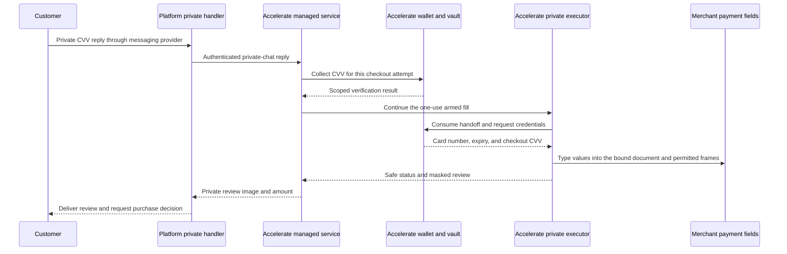

# Private CVV and credential delivery

Accelerate separates **customer verification** from **credential delivery to the checkout browser**. Your private handler receives the customer's CVV reply. A later one-use release supplies the card values to Accelerate's private executor. The executor types them into the payment fields of the customer's existing browser.

Here, private means that sensitive replies and card credentials stay outside model prompts, ordinary chat history, and agent tools. Trusted backend services, the messaging provider, the private executor, and the merchant's payment fields still handle raw values. This is not end-to-end encryption between the customer and the merchant's payment fields.

Start with [Agentic platforms](agentic-platforms.md) for setup.

## The two data paths

The agent receives safe status and progress events. It never receives the CVV reply, the card credentials, or access to the filled payment page.

## 1. Collect the CVV outside the agent

Your messaging ingress authenticates the provider request and resolves the customer, workspace, and direct conversation. It routes sensitive replies before any logging, history, tracing, ordinary queues, or model processing. See [Private messaging](private-messaging.md).

The server-only `AcceleratePrivateChatClient.chat.reply()` sends the reply to `/v1/checkouts/{id}/private-chat/reply`. It binds the reply to the customer, workspace, and conversation, and to the provider's message ID. The agent tools have no CVV argument.

The managed service accepts a CVV as a three- or four-digit string and keeps leading zeros. It checks the selected card and address, the frozen quote, the checkout revision, the armed fill, and the remaining review time. It then sends the CVV to Accelerate's sensitive handler, which collects it into the card vault.

The raw reply passes through your messaging provider, your private handler, and Accelerate's sensitive handlers. It is not entered in a hosted secure field.

The CVV challenge is used once. The verification must match the authenticated merchant, shopper, selected card, and exact checkout attempt, and must not be expired. The challenge also binds the quote and address.

Handlers clear reply objects and buffers after use. Disable request-body capture and secret-bearing error logs in your own stack. Clearing an object cannot remove a message that a provider or framework already stored.

## 2. Bind the fresh CVV to credential release

The vault returns a CVV alias. The wallet records a short-lived verification proof for the shopper, merchant, card, and checkout attempt. The database stores the alias, not the CVV digits.

At release, the wallet uses the exact alias collected for that checkout attempt, even if another checkout later updates the card. The release reports `cvvSource: 'collected_checkout'`. The executor receives the CVV only through this release, together with the selected card's number and expiry. It never receives the original chat reply.

CVV collection and proof are not an issuer authorization or a purchase.

## 3. Fill once

At creation, the checkout declares `fill_after_verification: true`. The approval request arms one fill for the exact checkout revision.

When the private CVV verifies, the service continues the fill inside the same private reply, under its exclusive checkout lease. It consumes the armed fill before it prepares the handoff or releases credentials. The agent does not need another turn or a fill tool.

The fill uses an expiring one-use handoff. It binds the shopper, card, address, amount and currency, destination, and checkout attempt. The executor consumes the handoff with its own authentication. The wallet then validates the credential formats, the selected card and amount, the fresh-CVV rule, and the `collected_checkout` marker before the fill.

A duplicate reply, an expired grant, a lost response, or an uncertain fill cannot authorize another release. Recovery reads the existing checkout. It never repeats the payment operation.

## 4. Fill the card fields

Accelerate's private executor attaches to the customer's existing browser over the trusted browser-control connection. It types each value with trusted browser keystrokes. Nothing is installed in the browser.

Before the fill, the executor checks the owned browser, the exact checkout document, the permitted payment frames, recording, the paused automation, and the remaining lifetime.

- It uses one visible, editable control for each value, in the admitted document or permitted payment-provider frames. If it finds two controls for one value, it types nothing and returns `checkout_unsupported` with reason `card_form_ambiguous`. This check runs at attachment and again before the credential release.
- It reads each value back after it types it. Provider formatting and masks are accepted when every visible digit matches. If a value does not read back, it empties the card fields and stops.
- Card values are never logged, returned to the agent, or put in an error.
- It never presses Enter and never clicks submit. Autosave is disabled.

Navigation, reload, URL changes, or tab removal invalidate the binding.

These controls limit what happens in a trusted browser. They do not revoke the browser provider account owner's access. Customer-owned browsers keep the `customer_backend_trusted` custody model.

## 5. Masked review, approval, final click, and cleanup

The executor applies display masks before the fill. The review shows the card number as stars plus the last four digits, the CVV as stars, and the expiry. The real payment fields keep the values that the merchant needs.

**Display masking protects the screen only.** It does not encrypt or remove the field values. Ordinary agent DOM, screenshot, and browser-control tools stay blocked during this period.

The customer receives the masked image and the exact final amount in the private channel. For a purchase, the confirmed sent receipt starts the five-minute decision window. The fill, the CVV, and the image do not approve a purchase. Fill-only tests cancel after the review.

After the customer approves, the customer's agent calls submit. The SDK checks readiness, arms the exact revision, calls your browser host's `performFinalClick` once, and completes the arm. Accelerate's executor never clicks. See [Purchase mode and checkout support](purchase-mode.md).

An in-page timer clears the card fields at a deadline, even if the executor's connection drops. When the checkout ends, cleanup empties every card control and confirms that each one is empty. The worker drops its credential references and retires the browser. An independent cleanup service handles any remaining cleanup after a worker failure.

These are cleanup controls, not a guarantee of memory zeroization. Browser memory, messaging-provider retention, and vault storage have separate boundaries.
